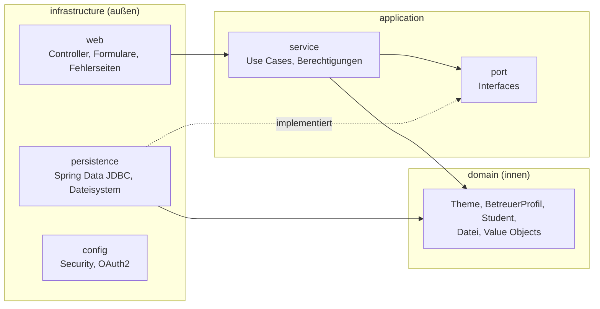

# Thesis 404 – Matching-Plattform für Abschlussarbeiten

Web-Anwendung, die **Studierende mit passenden Betreuer:innen und Themen für ihre Abschlussarbeit** zusammenbringt –
basierend auf besuchten Lehrveranstaltungen und Interessen.

> **Herkunft:** Entstanden als Teamprojekt (3 Personen) im *Programmierpraktikum 2* an der HHU Düsseldorf, WS 2025/26.
> Diese Version habe ich **nach dem Kurs eigenständig weiterentwickelt** – mit Schwerpunkt auf Sicherheit,
> Architektur und Tests (siehe [Weiterentwicklung](#weiterentwicklung-nach-dem-kurs)).

---

## Funktionen

| Rolle | Kann … |
|---|---|
| **Studierende** | Themen und Betreuer:innen nach Veranstaltungen/Interessen filtern (mit Ranking), Themen anfragen |
| **Betreuer:innen** | Profil pflegen (Kontakt, Fachgebiete, Dokumente), Themen anlegen/bearbeiten/löschen, Anfragen annehmen/ablehnen |
| **Admins** | Übersicht über alle Nutzer:innen |

**Matching:** Jede vom Thema geforderte Veranstaltung, die besucht wurde, zählt **+2**, jedes passende Fachgebiet **+1**.
Themen und Betreuer:innen werden nach Punktzahl absteigend sortiert.

**Login:** ausschließlich über **GitHub OAuth2**. Die Rolle ergibt sich beim Login:
`ROLE_ADMIN` über die Konfiguration `ADMIN_IDS`, `ROLE_BETREUER` wenn ein Betreuerprofil zur GitHub-ID existiert.

---

## Tech-Stack

| Bereich | Technologie |
|---|---|
| Sprache / Framework | Java 21, Spring Boot 3.5 (Web MVC, Security, Validation) |
| Persistenz | Spring Data JDBC, PostgreSQL 15, Flyway-Migrationen |
| Oberfläche | Thymeleaf, Bootstrap |
| Authentifizierung | Spring Security OAuth2 Client (GitHub) |
| Tests | JUnit 5, AssertJ, Mockito, Spring Security Test, **Testcontainers**, **ArchUnit** |
| Qualität | JaCoCo (Mindestabdeckung im Build), SpotBugs, GitHub Actions CI |
| Betrieb | Docker / Docker Compose |

---

## Architektur

Die Anwendung folgt der **Onion-Architektur** (Ports & Adapters). Abhängigkeiten zeigen nur nach innen:



- **Domain** – reine Fachlogik (nur `java.*`), z. B. Value Objects wie `Email`, `Fachgebiet`, `Veranstaltung` mit eingebauter Validierung.
- **Application** – Use Cases; hier liegen auch **alle Berechtigungsprüfungen** (z. B. „gehört das Thema diesem Betreuer?“).
- **Infrastructure** – Adapter nach außen. Beispiel: Für den `FileStoragePort` gibt es einen Festplatten-Adapter
  (Betrieb) und einen In-Memory-Adapter (Tests) – die Services merken davon nichts.

Die Regeln werden mit **ArchUnit** im Build geprüft (`ArchitectureTest`), u. a.:
Domain hängt nur von Java ab · Application kennt weder Web noch Infrastructure · Controller greifen nie direkt auf Ports zu.

Weitere Doku: [docs/Documentation.md](docs/Documentation.md) (Kontext & Bausteinsicht).

---

## Schnellstart

**Voraussetzungen:** Java 21, Docker (Desktop)

### 1. Datenbank starten

```bash
docker compose up -d        # PostgreSQL 15 auf localhost:5434
```

### 2. GitHub OAuth App anlegen

GitHub → *Settings → Developer settings → OAuth Apps → New OAuth App*

- Homepage URL: `http://localhost:8080`
- Authorization callback URL: `http://localhost:8080/login/oauth2/code/github`

### 3. Umgebungsvariablen setzen und starten

```bash
export CLIENT_ID=...          # aus der GitHub OAuth App
export CLIENT_SECRET=...
export ADMIN_IDS=12345678     # optional: numerische GitHub-IDs mit Admin-Rechten
./gradlew bootRun --args='--spring.profiles.active=dev'
```

Danach: <http://localhost:8080>

> In IntelliJ: *Run → Edit Configurations → Environment variables* und *Active profiles: `dev`*.
> Im Profil `dev` zeigt `/login-debug` die eigene GitHub-ID und Rollen an.
> Wie man sich selbst zum Betreuer macht: [docs/BETREUER_VIA_GITHUB.md](docs/BETREUER_VIA_GITHUB.md)

### Konfiguration

| Variable | Bedeutung | Standard |
|---|---|---|
| `CLIENT_ID`, `CLIENT_SECRET` | GitHub OAuth App | – (Pflicht) |
| `ADMIN_IDS` | Kommagetrennte GitHub-IDs mit Admin-Rolle | leer |
| `DB_URL` | JDBC-URL der Datenbank | `jdbc:postgresql://localhost:5434/thesis404` |
| `UPLOAD_DIR` | Ablageort hochgeladener Dateien | `./data/uploads` |

---

## Tests

```bash
./gradlew test      # alle Tests
./gradlew check     # Tests + Mindest-Testabdeckung (JaCoCo)
```

> **Docker muss laufen** – Integrations- und Repository-Tests starten über Testcontainers eine echte PostgreSQL
> und spielen dieselben Flyway-Migrationen ein wie in Produktion.

| Testart | Beispiele | Werkzeug |
|---|---|---|
| Domain-Unit-Tests | `StudentTest`, `EmailTest`, `LinkTest` | JUnit, AssertJ |
| Service-Unit-Tests | `ThemeServiceTest`, `DateiUploadServiceTest`, `AnfrageBerechtigungTest` | Mockito, Fakes, feste `Clock` |
| Repository-Tests | `ThemeRepositoryTest`, `OptimisticLockingTest`, `DateiPersistenzTest` | `@DataJdbcTest` + Testcontainers |
| Web/Security-Tests | `ZugriffsrechteTest` (Zugriffsmatrix, IDOR), `XssIntegrationTest`, `FehlerbehandlungTest` | MockMvc, Spring Security Test |
| Architektur | `ArchitectureTest` | ArchUnit |

Berichte: `build/reports/tests/test/index.html` und `build/reports/jacoco/test/html/index.html`.
Die CI ([.github/workflows/ci.yml](.github/workflows/ci.yml)) führt bei jedem Push `./gradlew build` aus.

---

## Sicherheit

- **Rollenbasierter Zugriff** in der `SecurityFilterChain` (Allowlist: nur ausdrücklich freigegebene Seiten sind öffentlich)
- **Besitzrechte im Service** – Schutz vor IDOR (fremde Themen/Dokumente/Anfragen über erratene IDs)
- **CSRF**: alle Zustandsänderungen nur per POST mit Token
- **XSS**: konsequentes Escaping (`th:text`), Links nur `http`/`https`
- **Uploads**: Typ- und Größenprüfung, zufällige Dateinamen, Schutz vor Path Traversal, Download nur als Attachment
- **Fehlerseiten** mit korrektem Status (403/404/409) ohne interne Details

---

## Weiterentwicklung nach dem Kurs

Gefunden und behoben bei einem eigenen Review des Teamprojekts – jeweils mit Tests abgesichert:

**Sicherheit**
- Admin-Bereich war für jeden eingeloggten Nutzer erreichbar → rollenbasierte Regeln
- Ein Test-Filter loggte anonyme Besucher als festen Test-User ein; `?testUser=` erlaubte Identitätswechsel → entfernt
- Löschen/Annehmen auch per GET-Link (CSRF-Schutz umgangen) → nur noch POST
- Regex-„XSS-Filter“ nur scheinbar wirksam → durch Escaping ersetzt, unsicheren `th:utext`-Code entfernt
- Erfundene Anfragen konnten „angenommen“ werden; ein Controller-Pfad umging die Besitzprüfung → Prüfungen im Service

**Architektur & Persistenz**
- Application-Schicht hing von Web-Formularen ab → Commands/DTOs, ArchUnit-Regeln verschärft
- 600-Zeilen-Controller in vier Controller aufgeteilt
- **Datei-Upload funktionierte nicht** (UPDATE statt INSERT bei selbst vergebener UUID) → `Persistable`
- Verwaiste Datei-Einträge beim Löschen; Dateien gingen beim Neustart verloren → Synchronisierung + Festplatten-Adapter
- Themen pro Betreuer wurden komplett geladen und in Java gefiltert → Derived Query + Index
- **Optimistic Locking** für Themen (kein stilles Überschreiben bei zwei offenen Tabs → HTTP 409)

**Tests & Build**
- H2 mit separatem Schema → Testcontainers-PostgreSQL mit denselben Flyway-Migrationen
- Repository-Tests als `@DataJdbcTest`-Slices, Unit-Tests für Services, Zugriffsmatrix
- Testbibliotheken aus dem Produktions-Classpath entfernt, CI mit GitHub Actions, JaCoCo-Mindestabdeckung

---

## Bekannte Grenzen / nächste Schritte

- Die Admin-Seiten „Profil / Thema / Nutzer anlegen“ sind noch **Platzhalter** und speichern nichts dauerhaft
- Datei-Uploads: zusätzlich Inhalt prüfen (Magic Bytes) statt nur die Dateiendung
- Entwicklungsdaten (Migrationen V3, V5, V7, V8) in ein eigenes Dev-Seed verschieben; DB-Passwort nur per Umgebungsvariable
- Optimistic Locking auch für Betreuerprofile
- Upgrade auf Testcontainers 2 (dann entfällt `src/test/resources/docker-java.properties`)

---

*Hinweise zum Einsatz von KI-Werkzeugen: siehe [ki.md](ki.md).*
