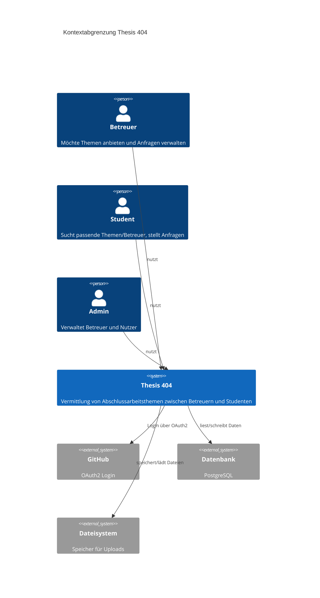
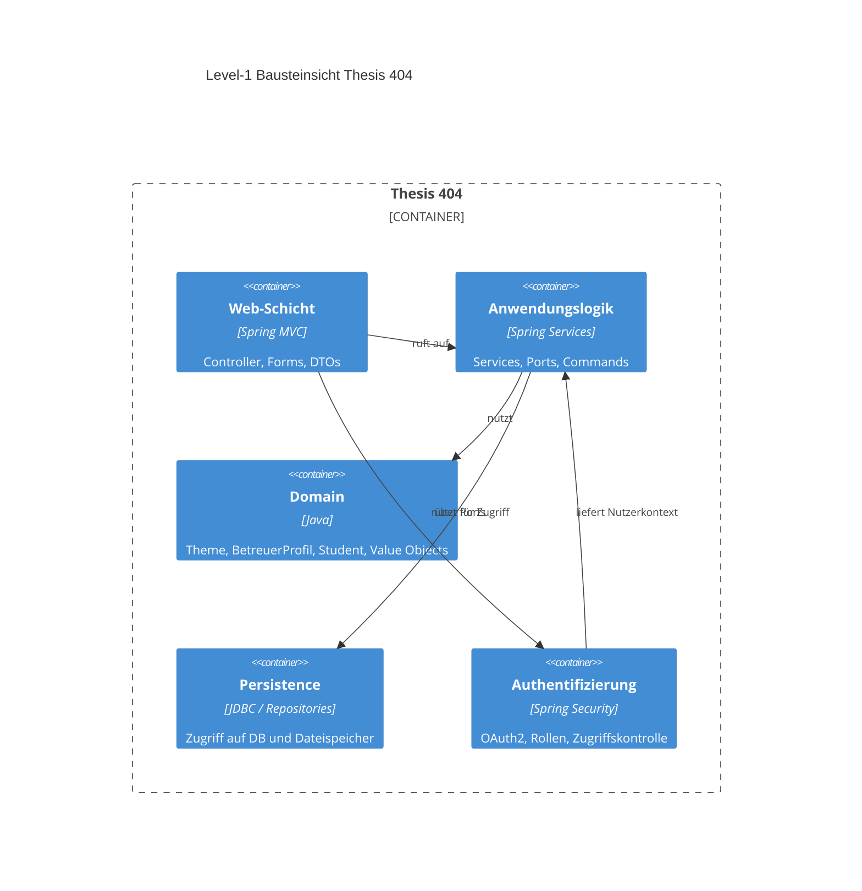

# Dokumentation Thesis 404

Diese Dokumentation beschreibt die Kontextabgrenzung und die grobe Bausteinsicht der Anwendung. Sie wurde einmal mit einer Rechtschreibprüfung überarbeitet (siehe Abschnitt am Ende).

---

## 1. Kontextabgrenzung

**Was gehört zum System?**

Die Anwendung „Thesis 404“ ist eine Web-App für die Vermittlung von Abschlussarbeiten. Betreuer können sich anmelden, ein Profil mit Fachgebieten und Kontaktdaten anlegen sowie Themen (Thesis-Themen) verwalten. Studenten können sich anmelden, ein Profil mit besuchten Veranstaltungen und Interessen anlegen und passende Themen bzw. Betreuer finden. Außerdem können Studenten Themen anfragen; Betreuer können diese Anfragen annehmen oder ablehnen. Admins können Betreuer- und Nutzerverwaltung durchführen.

**Was gehört nicht zum System?**

Alles, was außerhalb der eigenen Anwendung liegt: die konkrete Nutzung von GitHub (wir nutzen nur die Anmeldung), externe E-Mail-Systeme, Prüfungsämter oder andere Hochschulsysteme. Die App speichert nur die für die Vermittlung nötigen Daten; sie ersetzt keine offiziellen Prozesse der Hochschule.

**Schnittstellen nach außen**

- **Nutzer (Betreuer, Student, Admin):** Nutzen den Browser, um sich per GitHub anzumelden und die Webseiten zu bedienen.
- **GitHub (OAuth2):** Liefert die Anmeldung; die App erhält nur die zugesagten Daten (z. B. Name, GitHub-ID).
- **Datenbank:** Persistente Speicherung von Profilen, Themen, Studenten und Anfragen.
- **Dateisystem:** Speicherung hochgeladener Dateien (z. B. PDFs zu Themen oder Profilen).

### 1.1 Kontextabgrenzungsdiagramm

Das folgende Diagramm zeigt das System im Kontext seiner Nutzer und externen Systeme.

*Hinweis: Das Diagramm ist im C4-Kontext-Stil gehalten. Falls Mermaid nicht zur Verfügung steht, kann man es z. B. mit draw.io nachbilden.*

---

## 2. Level-1 Bausteinsicht

Die Anwendung wird in grober Form in folgende Bausteine unterteilt. Die Aufteilung orientiert sich an der Schichtenstruktur im Code (Web, Anwendung, Domain, Infrastruktur).

---

## 3. Erläuterung der Bausteine

### Web-Schicht

Hier laufen alle HTTP-Anfragen ein. Die Controller (z. B. `WebController`, `BetreuerProfilController`, `StudentController`) entscheiden, welche Seite oder Aktion ausgeführt wird. Sie nutzen Forms und DTOs für Ein- und Ausgabe und rufen die Anwendungslogik auf. Die Antworten sind vor allem HTML-Seiten (Thymeleaf). Fehler werden zentral im `GlobalExceptionHandler` abgefangen.

### Anwendungslogik (Services)

In dieser Schicht steckt die eigentliche Fachlogik, die nichts mit HTTP oder Datenbank zu tun hat. Beispiele: `ThemeService`, `BetreuerProfilService`, `StudentService`, `DateiUploadService`, `AdminUserListService`. Die Services arbeiten mit den Domain-Objekten und sprechen mit der Datenbank bzw. dem Dateispeicher nur über Ports (Interfaces). So bleibt die Logik testbar und unabhängig von der konkreten Speicherart.

### Domain

Die Domain enthält die fachlichen Begriffe und Regeln: z. B. `Theme`, `BetreuerProfil`, `Student`, `StudentThemeRequest` sowie Value Objects wie `ThemeId`, `ProfileId`, `Beschreibung`, `Fachgebiet`. Hier steht, was ein Thema oder ein Betreuerprofil ausmacht – ohne technische Details zu Web oder Datenbank.

### Persistence

Über Repositories (z. B. `JdbcThemeRepository`, `JdbcBetreuerProfilRepository`, `JdbcStudentRepository`) wird auf die Datenbank zugegriffen. Die Datei-Uploads werden über ein `FileStoragePort` abgelegt (z. B. im Dateisystem). Die Repositories übersetzen zwischen Domain-Objekten und Tabellen bzw. Dateien. So bleibt der Rest der Anwendung von der konkreten Speichertechnik getrennt.

### Authentifizierung

Spring Security übernimmt den Login per GitHub OAuth2. Ein eigener `CustomOAuth2UserService` und Success-Handler sorgen dafür, dass die GitHub-ID und Rollen (z. B. Admin) in der Anwendung ankommen. Die Betreuer-Zugehörigkeit wird über die in der Datenbank hinterlegte GitHub-ID des Betreuerprofils ermittelt. Die Web-Schicht prüft über Security-Konfiguration, wer welche URLs aufrufen darf (z. B. nur Betreuer unter `/betreuerProfil`).

---

## 4. Rechtschreibprüfung

Die Dokumentation wurde zumindest einmal mit einer Rechtschreibprüfung überarbeitet. Dafür kann z. B. die Rechtschreibprüfung der IDE (z. B. Language Tool, oder eingebaute Prüfung) oder ein externes Tool genutzt werden. In Cursor/VS Code: Rechtsklick im Editor → „Rechtschreibung prüfen“ bzw. entsprechende Extension für Deutsch aktivieren und durchlaufen lassen.